# AgentForge 架构设计文档

> 逆向生成自代码库，基于 56 个 Maven 模块、1,343 个 Java 源文件、~86,000 行主源码

---

## 1. 系统全景

### 1.1 产品定位

AgentForge 是一个面向企业级 AI Agent 的**全栈开发框架与图编排引擎**，覆盖 Agent 定义、编译、执行、治理、可观测的全生命周期。

与市面上的 Agent 框架（LangChain、CrewAI、AutoGen）不同，AgentForge 不仅仅关注 Agent 决策循环，而是提供从**图定义**到**生产部署**的完整链路：

- **声明式图编排**：通过 GraphDefinition 定义复杂工作流，支持 18 种节点类型和 4 种边类型
- **编译器流水线**：Graph → ResolvedGraph → GraphIR → ExecutionPlan，含路由优化与版本固定
- **企业级治理**：14 个专用治理类型覆盖 Skill 全生命周期（DRAFT → REVIEW → APPROVED → PUBLISHED → DEPRECATED → ARCHIVED）
- **分布式执行**：基于 Lease/Fencing 机制的 Worker 集群，支持水平扩展和故障恢复
- **安全纵深**：五层安全模型（认证 → 授权 → Skill 安全链 → 出口控制 → 审计）
- **多租户隔离**：基于 TenantContext 的完整租户隔离，贯穿数据、执行、Skill 注册

### 1.2 目标用户

| 用户角色 | 使用场景 | 接触模块 |
|---------|---------|---------|
| **Agent 开发者** | 使用 SDK/CLI 创建 Agent，通过 Graph 编排工作流 | sdk, cli, graph, compiler, agent |
| **平台运维/SRE** | 部署管理、监控执行、故障恢复 | server, distributed, control-plane, observability |
| **安全/合规团队** | 配置治理策略、审计日志、权限管理 | security, skill-governance, evaluation |
| **终端用户** | 通过 HTTP API 调用 Agent 应用 | server, sdk |

### 1.3 系统上下文图（C4 Level 1）

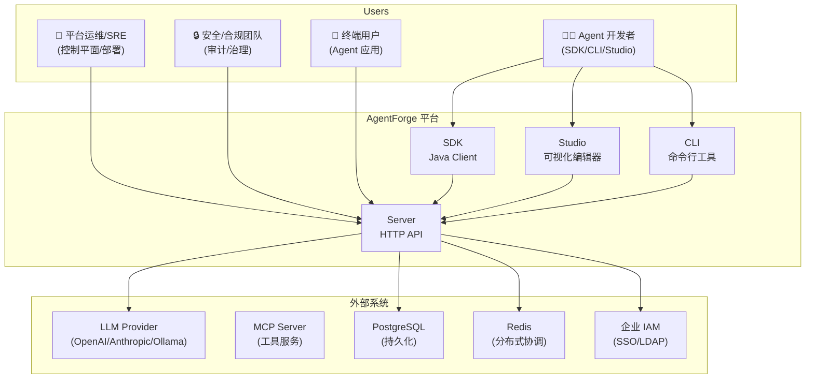

**关键交互说明：**

- **开发者**通过三种入口与平台交互：Studio 提供可视化图编辑器和执行控制台；CLI 提供命令行工具用于快速原型和脚本集成；SDK 提供 Java 原生 API 用于嵌入式集成
- **Server** 是唯一的 HTTP 入口点，所有外部系统交互都通过它进行。它负责认证、路由、执行编排
- **LLM Provider** 通过 provider-openai/anthropic/ollama 等适配器接入，统一抽象为 ChatModel/EmbeddingModel 接口
- **PostgreSQL** 存储权威状态：执行记录、激活、租约、事件、调用记录、Outbox
- **Redis** 通过 Redis Streams 实现至少一次投递的分布式任务队列

---

## 2. 分层架构

### 2.1 设计原则

AgentForge 采用严格的分层架构，遵循以下核心原则：

1. **依赖方向单一**：上层可以依赖下层，下层绝不能反向依赖上层
2. **SPI 倒置**：接口在消费方定义，实现在提供方提供（依赖倒置原则）
3. **内核纯净**：kernel 模块不依赖任何上层模块，仅包含纯抽象
4. **实现可替换**：每个 SPI 接口都有 InMemory 默认实现和生产级实现

### 2.2 七层模块分组

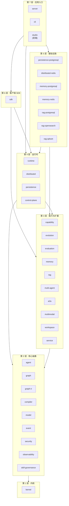

**各层详细职责：**

#### 第 1 层 · 内核（kernel + skill-governance）

**kernel** 是整个系统的基石，包含 19 个核心类型，定义了 AgentForge 的基础抽象：

- **实体基础**：`Entity`、`EntityId` — 所有领域对象的身份标识
- **版本管理**：`Version`（语义化版本 major.minor.patch）、`Definition` — 所有可版本化的定义
- **Skill 核心**：`Skill`、`SkillId`、`SkillDefinition`、`SkillDescriptor`、`SkillContract`、`SkillDependencies`、`SkillExecutionStrategy` — Skill 的完整定义模型
- **引用解析**：`CapabilityRef`、`SkillReference`、`ResolvedSkill` — Skill 依赖的解析链
- **Schema**：输入/输出的结构描述
- **配置**：`AgentForgeConfig`、`ConfigLoader` — 全局配置加载

**skill-governance** 从 kernel 拆分而来（架构修复 P0-3），包含 14 个治理类型：

- **治理配置**：`SkillGovernanceProfile`（聚合所有治理维度）、`SkillSecurityProfile`、`SkillDataBoundary`、`SkillExecutionConstraint`、`SkillEvaluationContract`
- **生命周期**：`SkillLifecycleState`（DRAFT → REVIEW → APPROVED → PUBLISHED → DEPRECATED → ARCHIVED）
- **风险管控**：`SkillRiskLevel`（LOW/MEDIUM/HIGH/CRITICAL）、`SkillErrorCode`
- **注册与查询**：`SkillRegistration`、`SkillQuery`、`SkillResult`、`SkillResultStatus`
- **完整性验证**：`SkillDigest`（哈希 + 签名 + 来源）、`SkillPackageMetadata`

**拆分原因**：kernel 应当保持纯净，仅包含最基础的抽象。治理类型虽然被广泛引用，但它们属于策略层而非基础层。将其拆分后，kernel 不依赖任何上层模块，而 capability/security/runtime 等需要治理的模块显式依赖 skill-governance。

#### 第 2 层 · 核心抽象

这一层定义了系统的主要领域概念，每个模块职责明确：

| 模块 | 文件数 | 核心职责 | 关键类型 |
|------|--------|---------|---------|
| **event** | 29 | 事件系统 + 执行状态类型 | ExecutionId, ExecutionEvent, EventPublisher, Execution, ExecutionState, ExecutionStatus, StateManager, EventBus, SpanTracker |
| **agent** | 31 | Agent 决策循环 | Agent, AgentLoop, AgentDecisionEngine, AgentContext, AgentDecision (Skill/Capability/Finish/Wait/Fail), BudgetTracker, StagnationDetector |
| **capability** | 48 | 能力抽象与 Skill 注册 | Capability, CapabilityProvider, CapabilityRegistry, SkillRegistry, InvocationPipeline, ToolAdapter, EvaluationEvidence (SPI) |
| **model** | 77 | LLM 模型抽象 | ChatModel, EmbeddingModel, RerankModel, ModelRegistry, ModelResolver, ModelRouter, Message (User/Assistant/Tool/System) |
| **graph** | 9 | 图定义模型 | GraphDefinition, NodeDefinition (18种NodeType), EdgeDefinition (4种EdgeType), GraphBuilder |
| **graph-ir** | 7 | 中间表示 + 执行计划 | GraphIR, IRNode, IREdge, ExecutionPlan, ExecutionNode, ExecutionPlanRegistry (SPI) |
| **compiler** | 10 | 图编译流水线 | GraphCompiler, CompilationContext, CompilationResult, CanonicalEncoder, ResolvedGraph |
| **security** | 52 | 安全纵深 | AuthenticationProvider, Authorizer, SkillSecurityChain, EgressControl, AuditLog, TenantContext, IAM (User/Role/Session/Tenant) |
| **observability** | 2 | 可观测性 | TraceIdentity, TraceMetrics |

#### 第 3 层 · 能力与扩展

这一层提供可扩展的高级能力，每个模块都是可选的：

| 模块 | 职责 | 依赖 |
|------|------|------|
| **evaluation** | Skill 评估门禁，通过 EvaluationEvidence SPI 与 capability 解耦 | kernel, capability |
| **evolution** | Skill 进化闭环：观察 → 评估 → 候选生成 → 实验验证 → 审批发布 | kernel |
| **memory** | Agent 记忆存储抽象 | kernel, security |
| **rag** | 检索增强生成：Retriever + Ranker + ContextBuilder | kernel, model, security |
| **multi-agent** | 多 Agent 协作：Delegate（委托）、Handoff（移交）、Collaborate（协作） | kernel, capability, agent, security |
| **a2a** | Agent-to-Agent 协议：AgentCard 发现、能力协商、任务流式传输 | provider-mcp |
| **multimodal** | 多模态消息处理：文本/图像/音频/视频/JSON/二进制 | kernel |
| **workspace** | 工作空间管理 | kernel, security |
| **control-plane** | 部署管理、环境隔离、发布编排 | kernel |
| **debugger** | 执行调试器 | event, runtime |
| **service** | 服务层抽象 | kernel |

#### 第 4 层 · 运行时

这一层是系统的执行核心：

| 模块 | 文件数 | 职责 | 关键类型 |
|------|--------|------|---------|
| **runtime** | 87 | 执行引擎 | ExecutionEngine, ExecutionManager, ExecutionStateMachine, NodeExecutor (6种实现), Scheduler, CommitPort (SPI), SkillInvoker, AgentNodeExecutor, HITL (ApprovalEngine/ApprovalPolicy) |
| **persistence** | 18 | 持久化 SPI | 各种 Store 接口 + InMemory 实现 |
| **distributed** | 38 | 分布式调度 | DistributedScheduler, Worker, WorkerRegistry, LeaseStore (SPI), TaskQueue (SPI), FencingValidator, TenantQuotaManager, Reconciler |
| **control-plane** | — | 控制平面 | 部署、环境、发布 |

#### 第 5 层 · 基础设施

这一层提供生产级实现，每个模块对应一个外部系统：

| 模块 | 对应系统 | 职责 |
|------|---------|------|
| **persistence-postgresql** | PostgreSQL | 持久化的 JDBC 实现 |
| **distributed-redis** | Redis | Redis Streams 任务队列（从 distributed 拆出，去除 Lettuce 依赖） |
| **memory-postgresql** | PostgreSQL | 记忆的 JDBC 实现 |
| **memory-redis** | Redis | 记忆的 Redis 实现 |
| **rag-postgresql** | PostgreSQL + pgvector | 向量存储的 JDBC 实现 |
| **rag-opensearch** | OpenSearch | 向量存储的 OpenSearch 实现 |
| **rag-qdrant** | Qdrant | 向量存储的 Qdrant 实现 |

#### 第 6 层 · 客户端 SDK

**sdk** 模块提供 Java 原生客户端 API，供嵌入式集成使用。它依赖核心抽象层，但不依赖基础设施层，允许消费者自行选择实现。

#### 第 7 层 · 应用入口

| 模块 | 职责 | 关键类型 |
|------|------|---------|
| **server** | HTTP 服务入口，基于 Netty | AgentForgeHttpController, ProductionApiHandler, ExecutionService, GraphService, SkillService, AuthHandler, HealthCheck, NettyServerBootstrap |
| **cli** | 命令行工具 | 交互式 CLI，支持图编辑、执行、调试 |
| **studio** | Web 前端（非 Maven 模块） | React + TypeScript，Graph Editor + Execution Console |

### 2.3 依赖方向约束

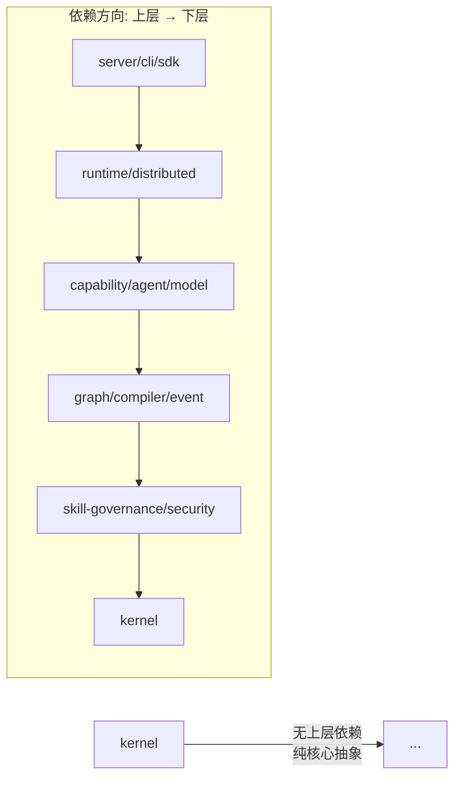

**核心原则：** 依赖只能从上到下，下层绝不反向依赖上层。这一约束通过架构测试（agentforge-architecture-tests）自动验证，任何违反依赖方向的提交都会被 CI 拦截。

**SPI 依赖倒置示例：**
- `capability` 模块定义 `EvaluationEvidence` 接口
- `evaluation` 模块实现 `SkillEvaluationEvidence`
- 编译期依赖方向：evaluation → capability（正确的下层方向）
- 运行时：capability 通过接口调用 evaluation 的实现

---

## 3. 核心领域模型

### 3.1 Kernel 核心类型

kernel 模块定义了 AgentForge 最基础的领域概念。所有类型都是不可变的 record 或接口，确保线程安全和值语义。

**设计决策：**

1. **为什么 Skill 是核心抽象？** 在 AgentForge 中，Skill 是 Agent 可以调用的最小能力单元。它可以是一个 LLM 调用、一个 API 调用、一个工具执行，甚至是一个子图。Skill 的统一抽象使得 Agent 可以无差别地调用各种能力。

2. **为什么用 record 而非 class？** record 提供不可变性、值语义、自动的 equals/hashCode/toString，这对于领域模型至关重要。所有 Skill 相关类型都是 record，确保它们在并发环境中安全传递。

3. **SkillDefinition 的五个维度：**
   - `SkillDescriptor`：描述 Skill 是什么（名称、描述、输入/输出 Schema）
   - `SkillContract`：描述 Skill 的保证（前置条件、后置条件）
   - `SkillDependencies`：描述 Skill 需要什么（依赖的 Capability 和其他 Skill）
   - `SkillExecutionStrategy`：描述 Skill 如何执行（超时、重试、隔离级别）
   - `SkillId` + `Version`：描述 Skill 的身份

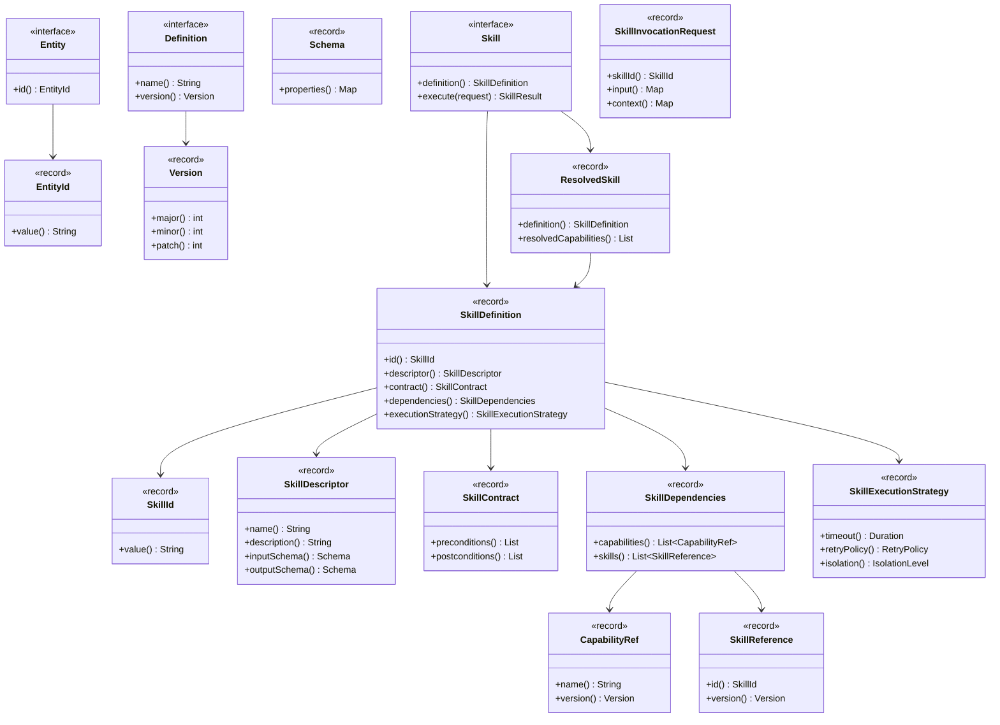

**类型职责说明：**

| 类型 | 职责 | 使用场景 |
|------|------|---------|
| `Entity` / `EntityId` | 所有领域对象的身份标识基础 | Execution、ExecutionPlan 等都有 EntityId |
| `Version` | 语义化版本（major.minor.patch） | Skill、Capability、Model 都有版本 |
| `Schema` | JSON Schema 风格的输入/输出描述 | SkillDescriptor 用它定义接口契约 |
| `Skill` | 可执行的 Skill 接口 | runtime 通过它调用任何 Skill |
| `SkillDefinition` | Skill 的完整静态定义 | 编译期解析、注册、查询 |
| `SkillDescriptor` | Skill 的描述性元数据 | UI 展示、API 文档、发现 |
| `SkillContract` | Skill 的行为契约 | 验证、测试生成 |
| `SkillDependencies` | Skill 的依赖声明 | 依赖解析、版本冲突检测 |
| `SkillExecutionStrategy` | 执行策略配置 | runtime 据此设置超时、重试 |
| `CapabilityRef` | 对 Capability 的引用 | SkillDependencies 中声明需要哪些能力 |
| `SkillReference` | 对另一个 Skill 的引用 | Skill 组合、依赖链 |
| `ResolvedSkill` | 解析后的 Skill（含已解析的 Capability） | runtime 执行时使用 |
| `SkillInvocationRequest` | Skill 调用请求 | Agent 发起 Skill 调用 |

### 3.2 Skill 治理体系（skill-governance 模块）

Skill 治理是 AgentForge 区别于其他 Agent 框架的核心特征。它提供了一套完整的企业级治理机制，确保每个 Skill 在其生命周期的每个阶段都受到适当的管控。

**治理维度说明：**

| 维度 | 类型 | 作用 |
|------|------|------|
| **风险等级** | `SkillRiskLevel` | 四级风险评估（LOW/MEDIUM/HIGH/CRITICAL），影响审批流程和安全检查强度 |
| **安全配置** | `SkillSecurityProfile` | 声明 Skill 需要的能力权限、出口策略、数据分类 |
| **数据边界** | `SkillDataBoundary` | 限制 Skill 可以访问的租户和数据分类 |
| **执行约束** | `SkillExecutionConstraint` | 限制执行时长、重试次数、资源使用 |
| **评估契约** | `SkillEvaluationContract` | 定义 Skill 的评估标准和阈值 |
| **生命周期** | `SkillLifecycleState` | 六阶段生命周期，状态转换有严格规则 |
| **完整性** | `SkillDigest` + `SkillPackageMetadata` | 哈希 + 签名 + 来源追踪，防止供应链攻击 |

**生命周期状态转换规则：**
- DRAFT → REVIEW：提交审核
- REVIEW → APPROVED：审核通过（需评估契约达标）
- APPROVED → PUBLISHED：发布到生产环境
- PUBLISHED → DEPRECATED：标记为废弃（仍可使用但不再推荐）
- DEPRECATED → ARCHIVED：归档（不再可用）
- 任何状态 → DRAFT：创建新版本

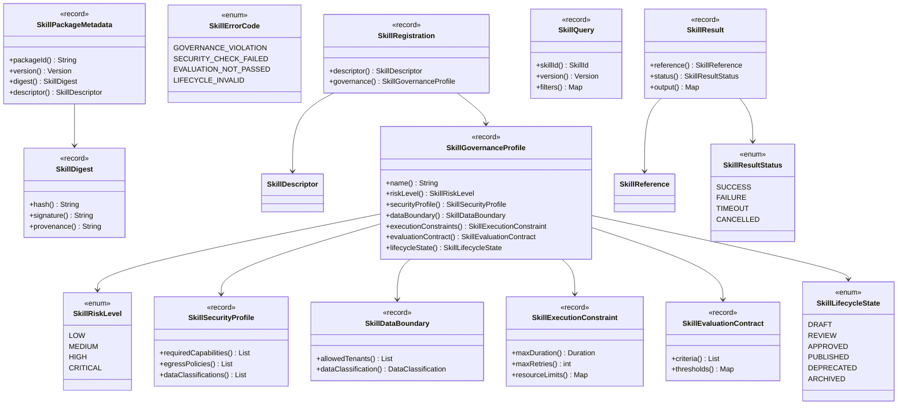

**治理检查点：**

Skill 治理不是事后的审计，而是嵌入到执行流程的每个关键节点：

1. **注册时**：`SkillRegistration` 必须包含完整的 `SkillGovernanceProfile`，否则拒绝注册
2. **解析时**：`SkillResolver` 检查 `SkillLifecycleState` 是否为 APPROVED 或 PUBLISHED
3. **调用前**：`SkillSecurityChain` 验证 `SkillSecurityProfile` 中的权限和出口策略
4. **执行中**：`SkillExecutionConstraint` 限制执行时长和资源使用
5. **执行后**：`SkillEvaluationContract` 评估执行结果是否达标
6. **跨租户**：`SkillDataBoundary` 确保数据不越界

---

## 4. 图编排引擎

### 4.1 设计哲学

AgentForge 的图编排引擎是其核心竞争力。与 LangGraph 等框架不同，AgentForge 采用**三阶段流水线**设计：

1. **编译阶段**：将声明式的 GraphDefinition 编译为规范化的 GraphIR 中间表示
2. **计划阶段**：将 GraphIR 转化为可执行的 ExecutionPlan，包含路由优化
3. **执行阶段**：ExecutionEngine 驱动 NodeExecutor 逐步执行

这种设计的优势在于：
- **编译期验证**：在编译阶段就能发现图结构错误（循环依赖、不可达节点、类型不匹配）
- **优化空间**：GraphIR 作为中间表示，允许进行路由优化、节点合并等编译期优化
- **执行解耦**：ExecutionPlan 与 GraphDefinition 解耦，同一个图可以有多种执行策略

### 4.2 编译流水线

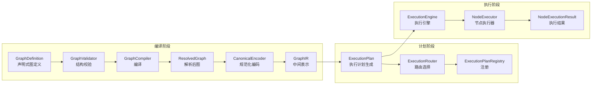

**编译阶段详解：**

1. **GraphValidator**：检查图的结构完整性
   - 必须有且仅有一个 START 节点
   - 至少有一个 END 节点
   - 所有节点必须从 START 可达
   - 不存在无入边的非 START 节点
   - 条件边的表达式语法合法

2. **GraphCompiler**：将 GraphDefinition 编译为 ResolvedGraph
   - 解析所有 SkillReference，验证 Skill 存在且版本兼容
   - 解析所有 CapabilityRef，验证 Capability 已注册
   - 展开 SUBGRAPH 节点为内联子图
   - 构建完整的依赖图

3. **CanonicalEncoder**：将 ResolvedGraph 编码为规范形式
   - 节点按拓扑序排列
   - 生成确定性哈希（用于缓存和去重）
   - 输出 GraphIR

**计划阶段详解：**

4. **ExecutionPlan 生成**：将 GraphIR 转化为执行步骤序列
   - 识别可并行执行的节点（PARALLEL 节点扇出）
   - 计算每个节点的前置依赖（JOIN 节点等待）
   - 为每个节点分配执行器名称

5. **ExecutionRouter**：路由选择
   - 根据条件表达式计算边的激活状态
   - 处理 CONDITION/SWITCH 节点的分支逻辑
   - 处理 LOOP/ITERATOR 节点的循环逻辑

6. **ExecutionPlanRegistry**：幂等注册
   - 同一个 GraphIR 多次注册返回同一个 planId
   - 支持按引用查找已注册的计划

### 4.3 图定义模型

GraphDefinition 是用户声明的入口，采用不可变 record 设计。

**节点类型详解（18 种）：**

| 类别 | 节点类型 | 职责 | 执行器 |
|------|---------|------|--------|
| **控制流** | START | 图的入口点，初始化执行上下文 | StartNodeExecutor |
| | END | 图的出口点，汇总执行结果 | EndNodeExecutor |
| **执行** | ACTION | 执行一个动作（函数调用） | ActionNodeExecutor |
| | AGENT | 启动 Agent 决策循环 | AgentNodeExecutor |
| | CAPABILITY | 调用一个 Capability | CapabilityNodeExecutor |
| | TOOL | 调用一个工具 | ToolNodeExecutor |
| | LLM | 直接调用 LLM | LLMNodeExecutor |
| | SKILL | 调用一个 Skill | SkillNodeExecutor |
| **分支** | CONDITION | 二分支条件判断（if/else） | ConditionNodeExecutor |
| | SWITCH | 多分支选择（switch/case） | SwitchNodeExecutor |
| **并行** | PARALLEL | 扇出并行执行多个分支 | ParallelNodeExecutor |
| | JOIN | 等待所有并行分支完成并汇合 | JoinNodeExecutor |
| **循环** | LOOP | 条件循环（while 语义） | LoopNodeExecutor |
| | ITERATOR | 遍历集合（for-each 语义） | IteratorNodeExecutor |
| **等待** | WAIT | 等待外部信号 | WaitNodeExecutor |
| | HUMAN | 人工审批（HITL） | HumanNodeExecutor |
| **嵌套** | SUBGRAPH | 执行子图 | SubgraphNodeExecutor |

**边类型详解（4 种）：**

| 类型 | 语义 | 使用场景 |
|------|------|---------|
| NORMAL | 无条件顺序执行 | A → B |
| CONDITIONAL | 条件满足时执行 | A →[condition] B |
| ERROR | 上游出错时执行（错误处理） | A →[error] ErrorHandler |
| LOOP_BACK | 回到之前的节点（循环） | A →[loop] B |

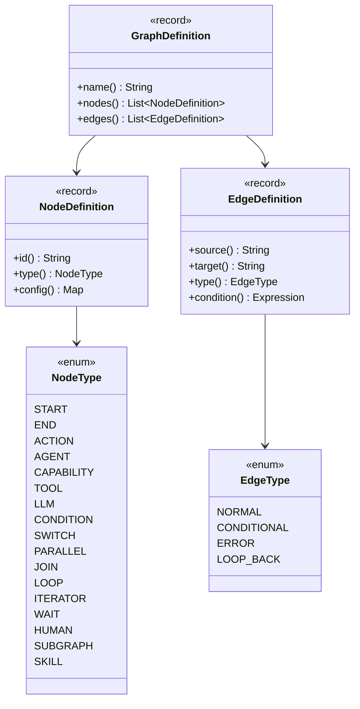

### 4.4 GraphIR 中间表示

GraphIR 是编译阶段的输出、计划阶段的输入。它与 GraphDefinition 的关键区别在于：

- **已解析**：所有 SkillReference 和 CapabilityRef 都已解析为具体引用
- **已验证**：所有结构约束已检查通过
- **规范化**：节点按拓扑序排列，具有确定性哈希
- **执行器绑定**：每个 IRNode 已绑定具体的 NodeExecutor 名称

ExecutionPlan 在 GraphIR 基础上增加了执行语义：
- `ExecutionNode` 包含执行器名称和依赖列表
- `ExecutionPlanRegistry` 提供幂等注册和查找

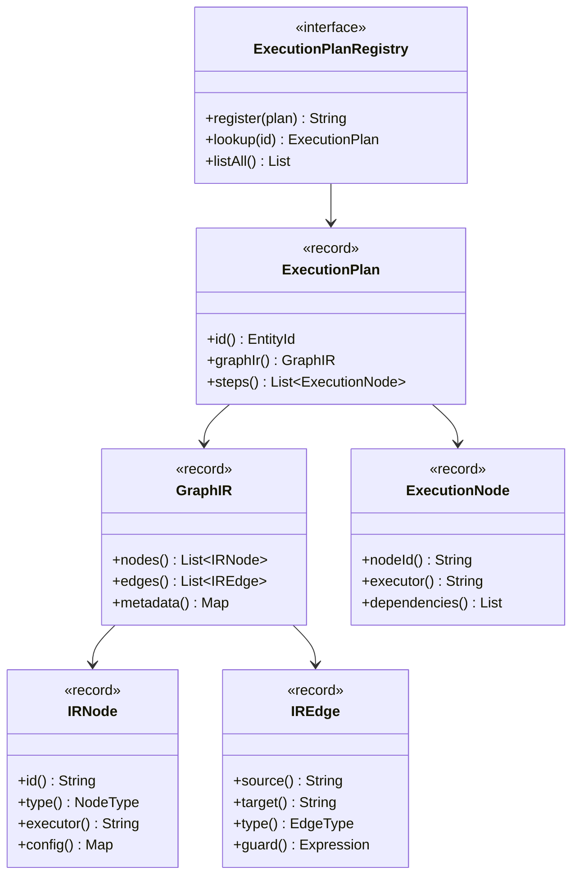

---

## 5. 运行时执行引擎

### 5.1 架构概述

运行时是 AgentForge 的执行核心，负责将编译好的 ExecutionPlan 转化为实际的执行。它采用分层设计：

- **入口层**：ExecutionService 接收请求，AgentForgeRuntime 管理生命周期
- **调度层**：ExecutionManager 管理执行的生命周期，Scheduler 分配任务到 Worker
- **执行层**：ExecutionEngine 驱动状态机，ExecutionRouter 决定下一步执行哪个节点
- **节点层**：NodeExecutorRegistry 管理各种 NodeExecutor，每种节点类型有专用执行器
- **辅助层**：EventPublisher 发布事件，StateManager 管理状态，CommitPort 保证事务性提交

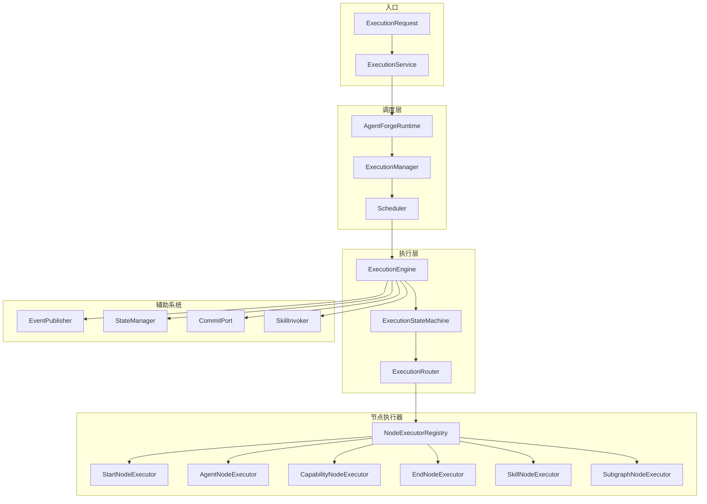

**关键组件职责：**

| 组件 | 职责 | 设计要点 |
|------|------|---------|
| **ExecutionEngine** | 驱动执行的核心引擎 | 每次执行一个节点，通过状态机管理转换 |
| **ExecutionStateMachine** | 管理执行状态转换 | 确保状态转换合法，防止非法状态 |
| **ExecutionRouter** | 路由决策 | 根据条件表达式和边类型决定下一个节点 |
| **NodeExecutorRegistry** | 执行器注册表 | 按 NodeType 查找对应的 NodeExecutor |
| **CommitPort** (SPI) | 事务性提交端口 | 保证状态变更、事件发布、租约更新的原子性 |
| **SkillInvoker** | Skill 调用器 | 解析 Skill 版本约束，调用正确的 Skill 实现 |

### 5.2 执行状态机

执行状态机管理每个 Execution 从提交到完成的生命周期。状态转换有严格的规则：

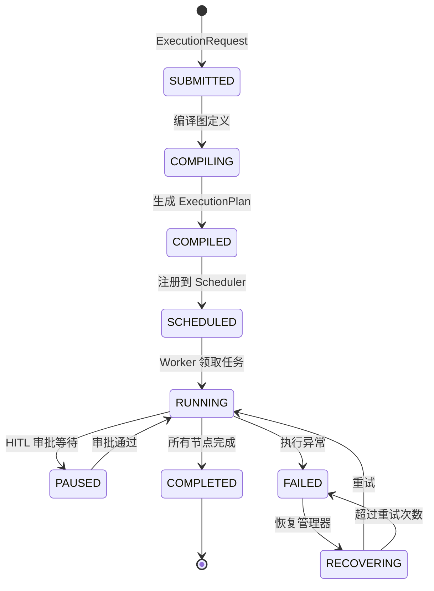

**状态转换规则：**

| 当前状态 | 目标状态 | 触发条件 | 副作用 |
|---------|---------|---------|--------|
| SUBMITTED | COMPILING | 开始编译 | 无 |
| COMPILING | COMPILED | 编译成功 | 生成 ExecutionPlan |
| COMPILING | FAILED | 编译失败 | 记录编译错误 |
| COMPILED | SCHEDULED | 注册到调度器 | 创建租约 |
| SCHEDULED | RUNNING | Worker 领取 | 更新租约 owner |
| RUNNING | PAUSED | HITL 审批请求 | 暂停执行，通知审批人 |
| PAUSED | RUNNING | 审批通过 | 恢复执行 |
| RUNNING | COMPLETED | 所有节点完成 | 发布完成事件 |
| RUNNING | FAILED | 异常 | 发布失败事件 |
| FAILED | RECOVERING | 恢复管理器介入 | 创建新租约 |
| RECOVERING | RUNNING | 重试 | 重新调度 |
| RECOVERING | FAILED | 超过重试次数 | 标记为最终失败 |

### 5.3 Agent 决策循环

Agent 是 AgentForge 中最复杂的节点类型。它实现了一个完整的**观察-思考-行动**循环：

1. **观察（Observe）**：AgentObservation 收集当前上下文，包括历史对话、工具结果、环境状态
2. **思考（Think）**：AgentDecisionEngine 基于观察做出决策
3. **行动（Act）**：通过 ActionExecutionPort 执行决策（调用 Skill/Capability）
4. **反馈（Feedback）**：执行结果反馈到 AgentContext，开始下一轮循环

**决策类型：**

| 决策 | 语义 | 触发条件 |
|------|------|---------|
| SkillDecision | 调用一个 Skill | LLM 决定使用某个工具/Skill |
| CapabilityDecision | 调用一个 Capability | LLM 决定使用某个底层能力 |
| FinishDecision | 结束循环 | LLM 认为任务完成 |
| WaitDecision | 等待信号 | 需要外部输入才能继续 |
| FailDecision | 失败退出 | 不可恢复的错误 |

**治理门禁：**

Agent 循环不是无限运行的，有三重保护机制：

- **BudgetTracker**：跟踪循环预算（最大步数、最大 Token 数、最大时间），超预算自动终止
- **PolicyGate**：策略门控，检查每步操作是否符合安全策略
- **StagnationDetector**：停滞检测，如果 Agent 连续多步没有实质性进展，自动终止

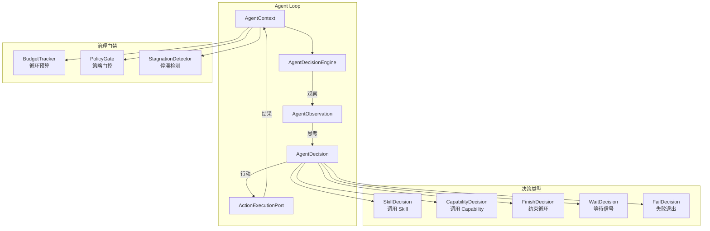

---

## 6. Provider SPI 体系

### 6.1 设计哲学

AgentForge 通过 SPI（Service Provider Interface）模式实现对外部服务的可替换接入。核心思想是：

1. **接口在消费方定义**：`provider-spi` 模块定义所有 Provider 必须实现的接口
2. **实现在提供方提供**：每个 provider-* 模块实现特定服务的适配器
3. **统一注册发现**：`ProviderRegistry` 管理所有 Provider 的注册和查找
4. **生命周期管理**：`LifecycleProvider` 接口统一管理 Provider 的初始化和关闭

**两类 Provider：**

| 类别 | 接口来源 | 实现模块 | 用途 |
|------|---------|---------|------|
| **模型 Provider** | model 模块的 ChatModel/EmbeddingModel | provider-openai, provider-anthropic, provider-ollama, provider-openai-compatible | 接入 LLM 服务 |
| **能力 Provider** | provider-spi 模块的 CapabilityProvider | provider-mcp, provider-http, provider-agent, provider-mock, provider-calculator | 接入工具/服务 |

### 6.2 Provider SPI 核心接口

`provider-spi` 模块定义了能力 Provider 的完整契约：

| 类型 | 职责 |
|------|------|
| `ProviderManifest` | Provider 的元数据描述（名称、版本、能力列表） |
| `ProviderCapabilityEntry` | 单个能力的声明（名称、描述、输入/输出 Schema） |
| `ProviderExecutionContext` | 执行上下文（超时、取消令牌、追踪信息） |
| `ProviderFailureCategory` | 失败分类（TIMEOUT/AUTH/RATE_LIMIT/NETWORK/INTERNAL） |
| `ProviderRegistry` | Provider 注册表接口 |
| `LifecycleProvider` | 生命周期管理接口（initialize/start/stop） |

### 6.3 Provider 架构总览

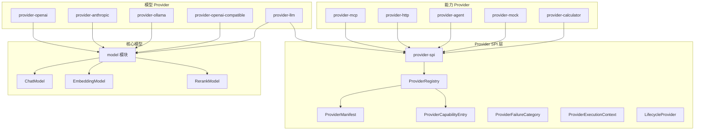

### 6.4 Provider 生命周期

每个 Provider 遵循统一的生命周期：注册 → 初始化 → 就绪 → 执行 → 关闭。

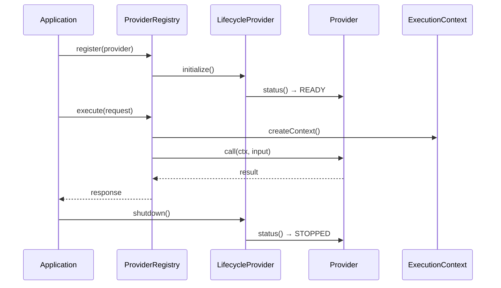

**Provider 健康检查：** 每个 Provider 实现 `AdapterHealth` 接口，报告其健康状态（HEALTHY/DEGRADED/UNHEALTHY），runtime 定期检查并自动摘除不健康的 Provider。

---

## 6.5 Agent 注册 SPI

### 6.5.1 设计目标

Agent 注册 SPI 允许用户开发自定义 Agent，打包为 jar 后放入 server classpath（或未来的 `plugins/` 目录），启动时通过 `ServiceLoader` 自动发现并注册到平台。Studio 前端通过 `GET /api/v1/agents` 系列端点实时感知和管理这些 Agent。

### 6.5.2 核心类型

| 类型 | 模块 | 职责 |
|------|------|------|
| `AgentRegistrar` | agentforge-agent | 扩展 `AgentRegistry`，新增生命周期/健康/指标/治理绑定 |
| `AgentProvider` | agentforge-agent | ServiceLoader SPI，用户实现此接口贡献 Agent 定义 |
| `AgentLifecycleState` | agentforge-agent | 6 态枚举：REGISTERED → STARTING → ACTIVE → DRAINING → STOPPED → FAILED |
| `AgentHealth` / `AgentMetrics` | agentforge-agent | 健康快照与运行时指标 |
| `RegistrationOptions` | agentforge-agent | 注册选项（治理绑定、标签、租户、autoStart） |
| `AgentForgeAgentRegistrar` | agentforge-server | 装饰器实现，包装 `InMemoryAgentRegistrar` + 事件发布 |
| `AgentApiHandler` | agentforge-server | HTTP REST handler，对接 Studio 前端 |

### 6.5.3 类图

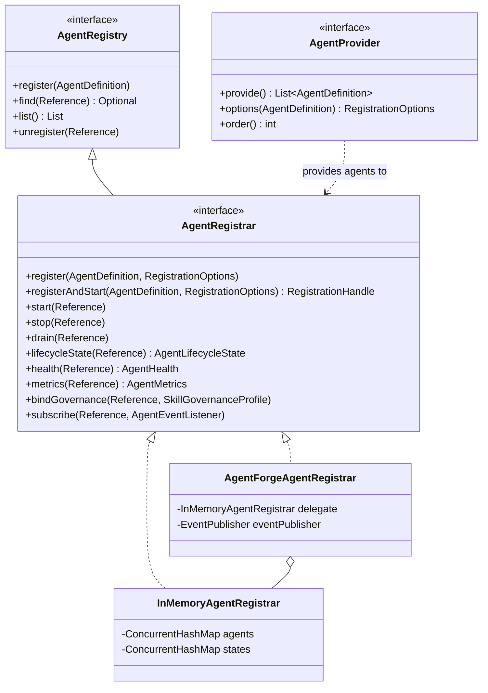

### 6.5.4 启动流程序列图

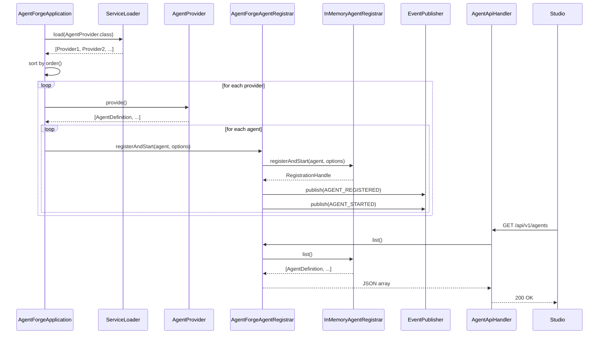

### 6.5.5 生命周期状态机

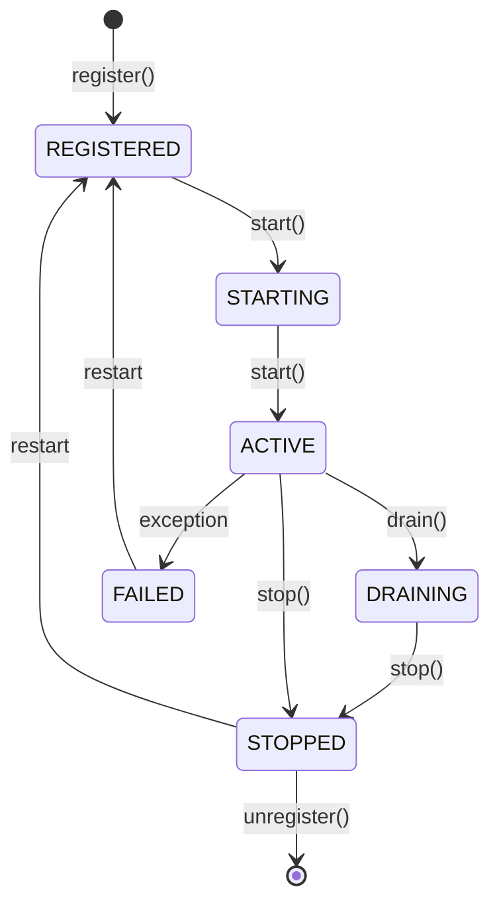

### 6.5.6 HTTP 端点

| 方法 | 路径 | 说明 |
|------|------|------|
| GET | `/api/v1/agents` | 列出所有 Agent |
| GET | `/api/v1/agents/summaries` | 轻量列表（Studio 列表页） |
| GET | `/api/v1/agents/{id}/overview` | 概览（状态 + 指标） |
| GET | `/api/v1/agents/{id}/definition` | Agent 定义 |
| GET | `/api/v1/agents/{id}/versions` | 多版本查询 |
| GET | `/api/v1/agents/{id}/health` | 健康快照 |
| GET | `/api/v1/agents/{id}/metrics` | 指标快照 |
| POST | `/api/v1/agents` | 注册新 Agent |
| POST | `/api/v1/agents/{id}/start` | 启动 |
| POST | `/api/v1/agents/{id}/stop` | 停止 |
| POST | `/api/v1/agents/{id}/drain` | 排空 |
| DELETE | `/api/v1/agents/{id}/{version}` | 注销 |

### 6.5.7 设计决策

| 决策点 | 选择 | 理由 |
|------|------|------|
| SPI 模块归属 | `agentforge-agent` | 与 `AgentRegistry` 同模块，向下兼容 |
| 是否替换 `AgentRegistry` | 不替换，扩展 | `AgentRegistrar extends AgentRegistry`，老代码零改动 |
| 自动发现机制 | ServiceLoader | Java 原生、零依赖、Maven 友好 |
| 事件发布 | 不进 SPI | agent 模块不依赖 event 模块，事件发布是 server 实现的副作用 |
| 热加载 | 第二期 plugins/ | 第一期要求用户把 Agent 打进 server fat jar |

---

## 7. 安全架构

### 7.1 五层纵深防御

AgentForge 采用五层纵深防御模型，每一层独立运作，即使某一层被突破，后续层仍能阻止攻击：

| 层次 | 模块 | 职责 | 关键类型 |
|------|------|------|---------|
| **第 1 层 · 认证** | security/iam | 验证身份 | AuthenticationProvider, IamBootstrap, SessionTokenProvider, ExternalIamAdapter |
| **第 2 层 · 授权** | security/auth | 检查权限 | Authorizer, PermissionBasedAuthorizer, RoleStore |
| **第 3 层 · Skill 安全链** | security/skill | Skill 级别的安全检查 | SkillSecurityChain, SkillGovernanceProfile, SkillSecurityProfile |
| **第 4 层 · 出口控制** | security/egress | 防止 SSRF 和数据泄露 | EgressControl, EgressPolicy, SsrfProtector |
| **第 5 层 · 审计** | security/audit | 完整操作审计日志 | AuditLog, AuditChain, AuditRetention |

### 7.2 安全纵深模型

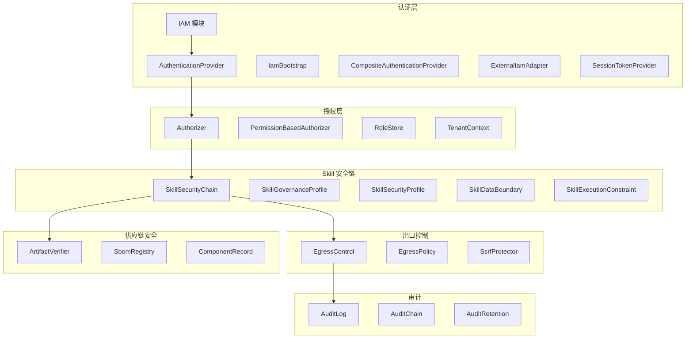

**认证层详解：**

AgentForge 支持多种认证方式的组合：

- `StaticTokenAuthenticationProvider`：静态 Token 认证（开发/测试用）
- `BuiltInAuthenticationProvider`：内置用户认证（用户名 + 密码）
- `ExternalIamAuthenticationProvider`：对接企业 IAM（SSO/LDAP/OAuth2）
- `CompositeAuthenticationProvider`：组合多种认证方式，按优先级尝试

**IAM 子系统：**

完整的身份与访问管理，包括：
- `User` / `UserStore`：用户管理
- `Role` / `RoleStore` / `RoleAssignment`：基于角色的权限
- `Tenant` / `TenantStore`：多租户管理
- `SessionStore` / `SessionTokenProvider`：会话管理
- `Organization`：组织层级
- `PasswordHasher`：密码哈希

**Skill 安全链详解：**

每次 Skill 调用都经过 SkillSecurityChain 的检查：

1. 检查 `SkillSecurityProfile.requiredCapabilities()` — Skill 是否有权限使用声明的能力
2. 检查 `SkillSecurityProfile.egressPolicies()` — Skill 的网络出口是否受限
3. 检查 `SkillDataBoundary.allowedTenants()` — Skill 是否可以访问当前租户的数据
4. 检查 `SkillExecutionConstraint` — Skill 的执行约束是否满足

### 7.3 多租户隔离

多租户隔离贯穿整个系统栈：

- **TenantContext**：基于 ThreadLocal 的租户上下文，所有操作都在特定租户范围内
- **SkillTenantIsolation**：Skill 注册表按租户隔离，租户 A 的 Skill 对租户 B 不可见
- **SkillDataBoundary**：数据边界限制，确保数据不跨租户泄露
- **TenantQuotaManager**：租户配额管理，限制每个租户的资源使用

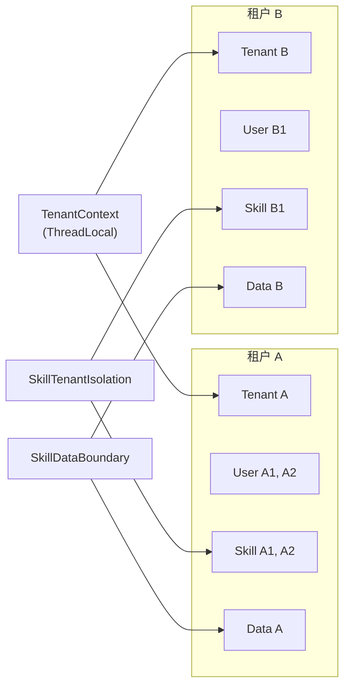

---

## 8. 分布式架构

### 8.1 设计目标

AgentForge 的分布式架构追求以下目标：

1. **水平扩展**：通过增加 Worker 节点提升吞吐量
2. **故障恢复**：Worker 宕机后自动重新调度其任务
3. ** exactly-once 语义**：通过 Lease/Fencing 机制保证每个任务只被一个 Worker 执行
4. **资源隔离**：通过租户配额防止单个租户耗尽资源
5. **优雅关闭**：Worker 关闭时等待在途任务完成，不丢失数据

### 8.2 核心组件

| 组件 | 职责 | SPI 接口 | 生产实现 |
|------|------|---------|---------|
| **DistributedScheduler** | 分布式任务调度 | Scheduler | 基于 LeaseStore + TaskQueue |
| **Worker** | 执行单元 | — | 每个 JVM 实例一个 Worker |
| **WorkerRegistry** | Worker 注册表 | — | 管理 Worker 的注册和发现 |
| **LeaseStore** | 租约存储 | ✅ | JdbcLeaseStore (PostgreSQL) |
| **TaskQueue** | 任务队列 | ✅ | RedisStreamsTaskQueue (Redis) |
| **FencingValidator** | Fencing Token 验证 | — | 防止脑裂 |
| **Reconciler** | 状态协调 | — | 检测和修复不一致 |
| **TenantQuotaManager** | 租户配额 | — | 资源隔离 |

### 8.3 分布式调度模型

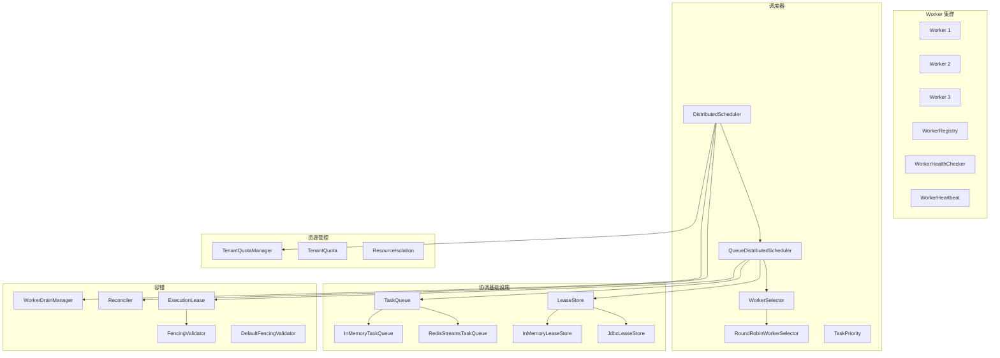

### 8.4 Lease/Fencing 机制

Lease/Fencing 是分布式调度的核心安全机制，防止同一个 Execution 被多个 Worker 同时执行（脑裂）。

**Lease（租约）：**
- 每个 Execution 在执行前必须获取租约
- 租约包含：executionId、workerId、fencing token、过期时间
- Worker 必须定期续约，否则租约过期后其他 Worker 可以获取

**Fencing Token（防护令牌）：**
- 每次获取租约都会获得一个递增的 fencing token
- 所有状态更新都必须携带 fencing token
- 存储层拒绝过期 token 的写入，防止旧 Worker 覆盖新 Worker 的状态

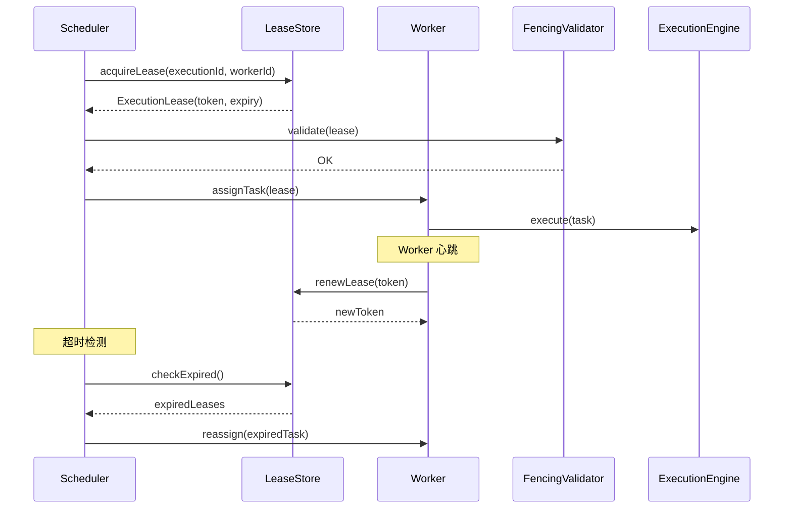

**故障恢复流程：**

1. Worker 宕机 → 心跳停止
2. WorkerHealthChecker 检测到 Worker 无响应
3. 该 Worker 持有的租约过期
4. Reconciler 发现过期租约，标记对应 Execution 为 RECOVERING
5. DistributedScheduler 重新获取租约，分配给其他 Worker
6. 新 Worker 从最近的 Checkpoint 恢复执行

### 8.5 资源管控

`TenantQuotaManager` 提供租户级别的资源隔离：

- **并发限制**：每个租户的最大并发执行数
- **速率限制**：每个租户的最大请求速率
- **资源配额**：每个租户的最大 CPU/内存使用

当配额超限时，抛出 `QuotaExceededException`，映射为 HTTP 429 Too Many Requests。

---

## 9. 事件与可观测性

### 9.1 事件系统

AgentForge 的事件系统支持三种模式：

1. **发布-订阅**：ExecutionEngine 发布事件，EventSubscriber 消费
2. **事件存储**：所有事件持久化到 EnvelopeEventStore，支持回放
3. **事件溯源**：通过 ReplayEngine 回放事件，重建执行状态

**事件类型体系：**

| 类型 | 职责 |
|------|------|
| `ExecutionEvent` | 执行事件基础类型（executionId, sequence, timestamp, type, payload） |
| `EventEnvelope` | 事件信封，包装事件元数据（时间戳、来源、追踪 ID） |
| `EventCategory` | 事件分类（EXECUTION/NODE/AGENT/SYSTEM） |
| `EventTypes` | 事件类型常量 |
| `EventFilter` | 事件过滤器 |

**事件存储：**

`EnvelopeEventStore` 提供事件的持久化存储：
- 按 executionId 查询事件时间线
- 支持事件回放（ReplayEngine）
- 支持背压控制（BackpressurePolicy）

**追踪系统：**

AgentForge 内置了分布式追踪支持：

| 类型 | 职责 |
|------|------|
| `ExecutionTrace` | 执行追踪，包含完整的执行路径 |
| `SpanTracker` | Span 追踪器，管理当前活跃的 Span |
| `Span` | 追踪 Span（类似 OpenTelemetry） |
| `SpanKind` | Span 类型（INTERNAL/CLIENT/SERVER/PRODUCER/CONSUMER） |
| `SpanStatus` | Span 状态（OK/ERROR/UNSET） |

**检查点机制：**

`CheckpointEngine` 定期保存执行状态，用于故障恢复：
- 每个节点完成后自动创建 Checkpoint
- Checkpoint 包含完整的执行状态快照
- 恢复时从最近的 Checkpoint 继续执行

```mermaid
graph TB
    subgraph "事件生产"
        EP["EventPublisher"]
        EF["EventFactory"]
        EE["ExecutionEngine"]
    end

    subgraph "事件总线"
        EB["EventBus"]
        IMEB["InMemoryEventBus"]
        EFILTER["EventFilter"]
        ECAT["EventCategory"]
    end

    subgraph "事件存储"
        EES["EnvelopeEventStore"]
        IMEES["InMemoryEnvelopeEventStore"]
        EEV["EventEnvelope"]
    end

    subgraph "事件消费"
        ES["EventSubscriber"]
        RE["ReplayEngine"]
        RM["ReplayMode"]
    end

    subgraph "追踪"
        ET["ExecutionTrace"]
        SP["SpanTracker"]
        SPAN["Span"]
        SPK["SpanKind"]
        SPS["SpanStatus"]
    end

    subgraph "检查点"
        CP["Checkpoint"]
        CPE["CheckpointEngine"]
        BP["BackpressurePolicy"]
    end

    EE --> EP
    EP --> EB
    EB --> EES
    EB --> ES
    EES --> RE
    EE --> ET
    ET --> SP
    EE --> CP
    CP --> CPE
```

### 9.2 可观测性栈

AgentForge 的可观测性覆盖三个维度：

| 维度 | 模块 | 关键类型 | 说明 |
|------|------|---------|------|
| **指标** | observability | TraceIdentity, TraceMetrics | 执行指标（延迟、吞吐、错误率） |
| **日志** | event + security | AuditLogger, AuditLog | 操作审计日志 |
| **追踪** | event | ExecutionTrace, Span, SpanTracker | 分布式追踪 |

**事件回放：**

`ReplayEngine` 支持两种回放模式：
- `ReplayMode.FULL`：完整回放所有事件
- `ReplayMode.INCREMENTAL`：仅回放自上次回放以来的新事件

---

## 10. 扩展能力模块

### 10.1 Memory 模块

Memory 模块为 Agent 提供长期记忆能力。每个记忆项包含内容、元数据和可选的向量嵌入。

**核心接口：**

- `MemoryStore`：存储/查询/删除记忆
- `MemoryItem`：记忆项（id, content, metadata, embedding）
- `MemoryProvenance`：记忆来源追踪（source, timestamp, executionId）

**实现：**

| 模块 | 存储后端 | 适用场景 |
|------|---------|---------|
| memory-postgresql | PostgreSQL | 生产环境，支持向量检索 |
| memory-redis | Redis | 低延迟缓存场景 |

### 10.2 RAG 模块

RAG（Retrieval-Augmented Generation）模块提供检索增强生成能力。

**核心流程：**

1. **Retriever**：根据查询从向量存储中检索相关文档
2. **Ranker**：对检索结果重新排序（使用 RerankModel）
3. **ContextBuilder**：将排序后的文档构建为 LLM 可用的上下文

**向量存储实现：**

| 模块 | 后端 | 特点 |
|------|------|------|
| rag-postgresql | PostgreSQL + pgvector | 与主库共享基础设施 |
| rag-opensearch | OpenSearch | 大规模向量检索 |
| rag-qdrant | Qdrant | 专业向量数据库 |

```mermaid
graph TB
    subgraph "RAG 核心"
        RAG["rag 模块"]
        RETRIEVER["Retriever"]
        RANKER["Ranker"]
        CONTEXT["ContextBuilder"]
    end

    subgraph "向量存储实现"
        RAGP["rag-postgresql"]
        RAGO["rag-opensearch"]
        RAGQ["rag-qdrant"]
    end

    subgraph "模型依赖"
        EMB["EmbeddingModel"]
        RERANK["RerankModel"]
        LLM["ChatModel"]
    end

    RAG --> RETRIEVER
    RAG --> RANKER
    RAG --> CONTEXT
    RAGP --> RAG
    RAGO --> RAG
    RAGQ --> RAG
    RAG --> EMB
    RAG --> RERANK
    CONTEXT --> LLM
```

### 10.3 Multi-Agent 协作

multi-agent 模块提供三种 Agent 间协作模式：

| 模式 | 语义 | 使用场景 |
|------|------|---------|
| **Delegate（委托）** | Agent A 将子任务委托给 Agent B，等待结果 | 任务分解、专家咨询 |
| **Handoff（移交）** | Agent A 将整个对话移交给 Agent B | 路由、升级 |
| **Collaborate（协作）** | 多个 Agent 协同完成一个任务 | 复杂推理、多角度分析 |

### 10.4 A2A 协议

a2a 模块实现 Agent-to-Agent 互操作协议：

- **AgentCard**：Agent 能力卡片，用于发现其他 Agent
- **CapabilityNegotiation**：能力协商，确定两个 Agent 之间的通信协议
- **TaskStream**：任务流式传输，支持长时间运行的跨 Agent 任务

a2a 模块依赖 provider-mcp，因为 A2A 协议复用了 MCP 的传输层。

### 10.5 Evaluation & Evolution

**Evaluation（评估）：**

evaluation 模块通过 SPI 模式与 capability 解耦：
- `EvaluationEvidence` 接口在 capability 模块定义
- `SkillEvaluationEvidence` 实现在 evaluation 模块
- `SkillEvaluationGateCheck` 在 Skill 调用前检查评估结果

**Evolution（进化）：**

evolution 模块实现 Skill 的持续改进闭环：
1. **观察**：收集 Skill 执行指标
2. **评估**：通过 evaluation 模块评估 Skill 质量
3. **候选生成**：基于评估结果生成改进候选
4. **实验验证**：在隔离环境中测试改进
5. **审批发布**：通过审批流程发布改进版本

```mermaid
graph LR
    subgraph "评估"
        EVAL["evaluation"]
        SEG["SkillEvaluationGateCheck"]
        EE["EvaluationEvidence<br/>(SPI接口)"]
        SEE["SkillEvaluationEvidence<br/>(实现)"]
    end

    subgraph "进化"
        EVOL["evolution"]
        CAND["CandidateGenerator"]
        EXP["ExperimentRunner"]
        APPR["ApprovalGate"]
    end

    EVAL --> EE
    SEE --> EE
    EVOL --> EVAL
    EVOL --> CAND
    CAND --> EXP
    EXP --> APPR
```

---

## 11. 部署架构

### 11.1 Docker 部署

开发/测试环境使用 Docker Compose：

| 服务 | 镜像 | 端口 | 职责 |
|------|------|------|------|
| agentforge-server | 自建 | 8080 | HTTP API 服务 |
| postgresql | postgres:16 | 5432 | 持久化存储 |
| redis | redis:7 | 6379 | 分布式协调 |

```mermaid
graph TB
    subgraph "Docker Compose"
        subgraph "应用层"
            AF["agentforge-server<br/>:8080"]
        end
        subgraph "数据层"
            PG["postgresql<br/>:5432"]
            RD["redis<br/>:6379"]
        end
    end

    AF --> PG
    AF --> RD
```

### 11.2 Kubernetes 部署

生产环境使用 Kubernetes，提供完整的部署清单：

| 资源 | 文件 | 职责 |
|------|------|------|
| Deployment | deployment.yaml | 应用部署，含就绪/存活探针 |
| Service | service.yaml | ClusterIP 服务暴露 |
| HPA | hpa.yaml | 基于 CPU/内存的自动伸缩 |
| ConfigMap | configmap.yaml | 应用配置 |
| Secret | secret-reference.yaml | 敏感信息引用 |
| ServiceAccount | serviceaccount.yaml | RBAC 身份 |

```mermaid
graph TB
    subgraph "Kubernetes Cluster"
        subgraph "Namespace: agentforge"
            DEP["Deployment<br/>agentforge-server"]
            SVC["Service<br/>ClusterIP:8080"]
            HPA["HPA<br/>自动伸缩"]
            CM["ConfigMap<br/>应用配置"]
            SEC["Secret<br/>敏感信息"]
            SA["ServiceAccount<br/>RBAC"]
        end
    end

    subgraph "外部依赖"
        PG["PostgreSQL"]
        RD["Redis"]
    end

    DEP --> SVC
    HPA --> DEP
    DEP --> CM
    DEP --> SEC
    DEP --> SA
    DEP --> PG
    DEP --> RD
```

**健康检查：**
- `DatabaseHealthCheck`：检查 PostgreSQL 连接
- `RedisHealthCheck`：检查 Redis 连接
- `RegistryHealthCheck`：检查 Skill/Capability 注册表
- `HealthAggregator`：聚合所有健康检查状态

### 11.3 生产装配详解

PRODUCTION 模式下，AgentForge 自动装配 PostgreSQL + Redis 全链路持久化。

**PostgreSQL 表结构（双 Schema）：**

| Schema | 表名 | 职责 |
|--------|------|------|
| `agentforge_server` | `iam_user` / `iam_tenant` / `iam_role` / `iam_role_assignment` / `iam_session` | 身份与访问管理 |
| `agentforge_server` | `execution_plan` | 编译后的执行计划（graph_id + graph_version 主键） |
| `agentforge_server` | `server_execution` / `server_execution_event` | HTTP 层执行记录与事件时间线 |
| `public` | `execution_state` / `execution` / `execution_event` | 运行时执行状态与事件 |
| `public` | `checkpoint` / `snapshot` / `outbox_message` / `invocation` | 检查点、快照、Outbox、调用记录 |

**Redis Key 设计：**

| Key Pattern | 类型 | 职责 |
|-------------|------|------|
| `agentforge:lease:{executionId}` | String | 分布式租约（workerId:fencingToken:expiresAt） |
| `agentforge:lease:token-counter` | String (INCR) | 单调递增 fencing token 计数器 |
| `agentforge:workers` | Hash | Worker 注册表（workerId → registration JSON） |
| `agentforge:leader` | String (NX+PX) | Leader 选举锁 |
| `agentforge:task-queue:{queueName}` | Stream | Redis Streams 任务队列 |

**装配流程：**

```mermaid
graph LR
    A[AgentForgeApplication.build] --> B{database.type?}
    B -->|postgresql| C[PostgresPersistenceModule]
    B -->|memory| D[InMemory Stores]
    C --> E[JdbcCommitPort]
    C --> F[JdbcExecutionPlanRegistry]
    C --> G[JdbcServerExecutionStore]
    C --> H[JdbcIamStores]
    
    A --> I{redis.uri?}
    I -->|configured| J[RedisLeaseStore]
    I -->|configured| K[RedisWorkerRegistrationStore]
    I -->|configured| L[RedisLeaderElection]
    I -->|configured| M[RedisStreamsTaskQueue]
    
    J --> N[WorkerTaskExecutor]
    K --> N
    L --> O[DefaultReconciler]
    M --> N
```

**环境变量清单：**

| 变量 | 必填 | 说明 |
|------|------|------|
| `AGENTFORGE_DEPLOYMENT_MODE` | 是 | `production` 或 `demo` |
| `AGENTFORGE_DATABASE_TYPE` | 是 | `postgresql` 或 `memory` |
| `AGENTFORGE_DATABASE_URL` | 生产必填 | JDBC URL |
| `AGENTFORGE_DATABASE_USERNAME` | 生产必填 | 数据库用户 |
| `AGENTFORGE_DATABASE_PASSWORD` | 生产必填 | 数据库密码 |
| `AGENTFORGE_REDIS_URI` | 生产必填 | Redis URI（如 `redis://localhost:6379`） |
| `AGENTFORGE_SESSION_SIGNING_KEY` | 生产必填 | 64+ 字符 hex，用于 JWT 签名 |
| `AGENTFORGE_ADMIN_PASSWORD` | 是 | 初始 admin 密码 |

---

## 12. 模块依赖全景图

下图展示了全部 56 个模块的依赖关系，按层分组着色：

```mermaid
graph TB
    subgraph "内核层"
        K["kernel"]
        SG["skill-governance"]
    end

    subgraph "核心抽象层"
        E["event"]
        AG["agent"]
        CAP["capability"]
        M["model"]
        G["graph"]
        GIR["graph-ir"]
        C["compiler"]
        SEC["security"]
        OBS["observability"]
    end

    subgraph "运行时层"
        RT["runtime"]
        P["persistence"]
        D["distributed"]
    end

    subgraph "扩展层"
        MA["multi-agent"]
        EVAL["evaluation"]
        EVOL["evolution"]
        MEM["memory"]
        RAG["rag"]
        A2A["a2a"]
        MM["multimodal"]
        WS["workspace"]
        SVC["service"]
        CTRL["control-plane"]
        DBG["debugger"]
    end

    subgraph "Provider 层"
        PS["provider-spi"]
        PO["provider-openai"]
        PA["provider-anthropic"]
        POA["provider-ollama"]
        POC["provider-openai-compatible"]
        PLLM["provider-llm"]
        PMCP["provider-mcp"]
        PH["provider-http"]
        PAG["provider-agent"]
        PMOCK["provider-mock"]
        PCALC["provider-calculator"]
    end

    subgraph "基础设施层"
        PGP["persistence-postgresql"]
        DR["distributed-redis"]
        MEMP["memory-postgresql"]
        MEMR["memory-redis"]
        RAGP["rag-postgresql"]
        RAGO["rag-opensearch"]
        RAGQ["rag-qdrant"]
    end

    subgraph "应用层"
        SRV["server"]
        CLI["cli"]
        SDK["sdk"]
    end

    SG --> K
    E --> K
    AG --> K
    AG --> CAP
    CAP --> K
    CAP --> SG
    M --> K
    G --> K
    G --> AG
    G --> CAP
    GIR --> K
    GIR --> G
    C --> K
    C --> AG
    C --> CAP
    C --> G
    C --> GIR
    SEC --> K
    SEC --> SG
    RT --> K
    RT --> SG
    RT --> E
    RT --> AG
    RT --> CAP
    RT --> M
    RT --> G
    RT --> GIR
    RT --> SEC
    RT --> C
    P --> K
    P --> GIR
    P --> E
    D --> RT
    D --> P
    D --> GIR
    D --> K
    D --> G
    D --> C
    D --> CAP

    PS --> K
    PS --> CAP
    PO --> M
    PA --> M
    POA --> M
    POC --> M
    PLLM --> M
    PLLM --> PS
    PMCP --> PS
    PH --> PS
    PAG --> PS
    PMOCK --> PS
    PCALC --> PS

    PGP --> P
    DR --> D
    MEMP --> MEM
    MEMR --> MEM
    RAGP --> RAG
    RAGO --> RAG
    RAGQ --> RAG

    MA --> K
    MA --> CAP
    MA --> AG
    MA --> SEC
    EVAL --> K
    EVAL --> CAP
    RAG --> K
    RAG --> M
    RAG --> SEC
    MEM --> K
    MEM --> SEC

    SRV --> K
    SRV --> G
    SRV --> GIR
    SRV --> C
    SRV --> RT
    SRV --> SEC
    SRV --> SG
    SRV --> CAP
    SRV --> OBS
    SRV --> P
    SRV --> PGP
    SRV --> D
    SDK --> K
    SDK --> SG
    SDK --> M
    SDK --> AG
    SDK --> CAP
    SDK --> G
    SDK --> GIR
    SDK --> RT
    SDK --> SEC
    CLI --> K
    CLI --> G
    CLI --> GIR
    CLI --> C
    CLI --> RT
    CLI --> SRV
    CLI --> SEC
    CLI --> CAP
    CLI --> OBS
```

---

## 13. 关键设计模式

### 13.1 SPI（Service Provider Interface）模式

SPI 是 AgentForge 最核心的设计模式。它遵循"接口在消费方定义，实现在提供方提供"的原则，实现模块间的松耦合。

**SPI 接口清单：**

| SPI 接口 | 定义位置 | 实现 | 用途 |
|---------|---------|------|------|
| `EvaluationEvidence` | capability | SkillEvaluationEvidence (evaluation) | Skill 评估证据 |
| `StateManager` | event | InMemoryStateManager (runtime) | 执行状态管理 |
| `ExecutionPlanRegistry` | graph-ir | InMemoryExecutionPlanRegistry (runtime) | 执行计划注册 |
| `CommitPort` | runtime | InMemoryCommitPort (runtime) | 事务性提交 |
| `LeaseStore` | distributed | JdbcLeaseStore (distributed) | 租约存储 |
| `TaskQueue` | distributed | RedisStreamsTaskQueue (distributed-redis) | 任务队列 |
| `ChatModel` | model | provider-openai/anthropic/ollama 等 | LLM 对话 |
| `EmbeddingModel` | model | provider-openai/ollama 等 | 向量嵌入 |

```mermaid
graph LR
    subgraph "消费方定义接口"
        SPI1["EvaluationEvidence<br/>(capability模块)"]
        SPI2["StateManager<br/>(event模块)"]
        SPI3["ExecutionPlanRegistry<br/>(graph-ir模块)"]
        SPI4["CommitPort<br/>(runtime模块)"]
        SPI5["LeaseStore<br/>(distributed模块)"]
        SPI6["TaskQueue<br/>(distributed模块)"]
    end

    subgraph "提供方实现"
        IMPL1["SkillEvaluationEvidence<br/>(evaluation模块)"]
        IMPL2["InMemoryStateManager<br/>(runtime模块)"]
        IMPL3["InMemoryExecutionPlanRegistry<br/>(runtime模块)"]
        IMPL4["InMemoryCommitPort<br/>(runtime模块)"]
        IMPL5["JdbcLeaseStore<br/>(distributed模块)"]
        IMPL6["RedisStreamsTaskQueue<br/>(distributed-redis模块)"]
    end

    IMPL1 -.->|implements| SPI1
    IMPL2 -.->|implements| SPI2
    IMPL3 -.->|implements| SPI3
    IMPL4 -.->|implements| SPI4
    IMPL5 -.->|implements| SPI5
    IMPL6 -.->|implements| SPI6
```

### 13.2 依赖倒置（DIP）

依赖倒置是 SPI 模式的理论基础。高层模块不依赖低层模块的实现细节，两者都依赖抽象。

**典型示例：capability → evaluation 解耦**

- **问题**：capability 模块需要检查 Skill 评估结果，但不应该直接依赖 evaluation 模块
- **解决**：在 capability 中定义 `EvaluationEvidence` 接口，evaluation 中的 `SkillEvaluationEvidence` 实现它
- **结果**：依赖方向从 capability → evaluation 反转为 evaluation → capability

```mermaid
graph TB
    subgraph "高层模块"
        CAP["capability"]
        RT["runtime"]
        P["persistence"]
    end

    subgraph "低层模块"
        EVAL["evaluation"]
        DIST["distributed"]
        PGP["persistence-postgresql"]
    end

    subgraph "SPI 接口（在高层定义）"
        EE["EvaluationEvidence"]
        LS["LeaseStore"]
        PS["PersistenceStore"]
    end

    subgraph "SPI 实现（在低层提供）"
        SEE["SkillEvaluationEvidence"]
        JLS["JdbcLeaseStore"]
        JPS["JdbcPersistenceStore"]
    end

    CAP --> |"定义"| EE
    EVAL --> |"实现"| SEE
    SEE -.-> EE

    RT --> |"定义"| LS
    DIST --> |"实现"| JLS
    JLS -.-> LS

    P --> |"定义"| PS
    PGP --> |"实现"| JPS
    JPS -.-> PS
```

### 13.3 管道-过滤器模式

管道-过滤器模式用于需要多阶段处理的场景。每个阶段独立可替换，通过管道串联。

**InvocationPipeline（capability 模块）：**

Skill 调用的处理管道，包含 5 个阶段：
1. **验证阶段**：检查输入参数合法性
2. **治理检查**：验证 Skill 治理配置
3. **安全审查**：SkillSecurityChain 安全检查
4. **执行阶段**：实际调用 Skill
5. **审计记录**：记录操作审计日志

**OutputProcessingPipeline（runtime 模块）：**

Skill 输出的后处理管道：
1. **JsonParserStage**：解析 JSON 输出
2. **NormalizerStage**：规范化输出格式
3. **ValidationStage**：验证输出符合 Schema

```mermaid
graph LR
    subgraph "InvocationPipeline (capability)"
        S1["Stage 1<br/>验证"] --> S2["Stage 2<br/>治理检查"]
        S2 --> S3["Stage 3<br/>安全审查"]
        S3 --> S4["Stage 4<br/>执行"]
        S4 --> S5["Stage 5<br/>审计记录"]
    end

    subgraph "OutputProcessingPipeline (runtime)"
        O1["JsonParserStage"] --> O2["NormalizerStage"]
        O2 --> O3["ValidationStage"]
    end
```

### 13.4 状态机模式

ExecutionStateMachine 使用显式状态机模式管理执行状态转换。每次状态转换都经过合法性检查，防止非法状态跳转。

### 13.5 注册表模式

多个组件使用注册表模式管理可插拔的实现：

| 注册表 | 管理对象 | 查找方式 |
|--------|---------|---------|
| SkillRegistry | Skill 实现 | 按 SkillId + Version |
| CapabilityRegistry | Capability 实现 | 按名称 + 版本 |
| NodeExecutorRegistry | NodeExecutor | 按 NodeType |
| ProviderRegistry | Provider | 按名称 |
| AgentRegistry | Agent 定义 | 按名称 |
| ModelRegistry | Model 定义 | 按名称 + 能力查询 |

---

## 14. 数据流全景

### 14.1 端到端执行流

从用户提交请求到获得结果的完整数据流：

1. **提交阶段**：用户通过 SDK/CLI/HTTP 提交 GraphDefinition
2. **编译阶段**：Server 调用 Compiler 将 GraphDefinition 编译为 ExecutionPlan
3. **调度阶段**：Runtime 将 ExecutionPlan 注册到调度器，分配 Worker
4. **执行阶段**：ExecutionEngine 驱动 NodeExecutor 逐步执行每个节点
5. **完成阶段**：所有节点完成后，汇总结果返回给用户

```mermaid
sequenceDiagram
    participant User as 用户
    participant SDK as SDK/CLI
    participant Server as Server
    participant Compiler as Compiler
    participant Runtime as Runtime
    participant Engine as ExecutionEngine
    participant Agent as AgentLoop
    participant Provider as Provider
    participant LLM as LLM
    participant Persist as Persistence
    participant Event as EventBus

    User->>SDK: 提交 Graph 定义
    SDK->>Server: POST /api/graphs/execute
    Server->>Compiler: compile(graphDefinition)
    Compiler-->>Server: ExecutionPlan
    Server->>Runtime: submit(plan)
    Runtime->>Engine: start(execution)
    Engine->>Event: publish(ExecutionStarted)
    
    loop 节点执行
        Engine->>Agent: executeNode(node)
        Agent->>Provider: call(capability)
        Provider->>LLM: chat(request)
        LLM-->>Provider: response
        Provider-->>Agent: result
        Agent-->>Engine: nodeResult
        Engine->>Persist: saveState(state)
        Engine->>Event: publish(NodeCompleted)
    end

    Engine->>Event: publish(ExecutionCompleted)
    Engine-->>Runtime: result
    Runtime-->>Server: executionResult
    Server-->>SDK: response
    SDK-->>User: 结果
```

### 14.2 HITL（Human-in-the-Loop）审批流

当执行到需要人工审批的节点（HUMAN 类型）时，触发 HITL 流程：

1. **风险评估**：ApprovalEngine 评估当前操作的风险等级
2. **策略判定**：ApprovalPolicy 根据风险等级决定是否需要审批
3. **执行暂停**：如果需要审批，暂停执行并创建审批请求
4. **人工决策**：审批人查看上下文后做出批准/拒绝决定
5. **执行恢复**：根据审批结果恢复或终止执行

```mermaid
sequenceDiagram
    participant Engine as ExecutionEngine
    participant HITL as ApprovalEngine
    participant Policy as ApprovalPolicy
    participant Human as 审批人
    participant Resume as 执行恢复

    Engine->>HITL: requestApproval(context)
    HITL->>Policy: evaluate(riskAssessment)
    Policy-->>HITL: requiresApproval = true
    HITL->>Engine: pause(execution)
    Engine->>HITL: createApprovalRequest()
    HITL->>Human: notify(approvalRequest)
    Human->>HITL: decide(approve/reject)
    HITL->>Resume: resume(execution)
    Resume->>Engine: continue(node)
```

**审批上下文：**

审批人可以看到的信息：
- 当前执行状态和历史
- 触发审批的节点配置
- 风险评估结果（RiskAssessment）
- 上下文脱敏后的数据（ContextRedactor 自动脱敏敏感信息）

---

## 15. 模块统计

| 分组 | 模块数 | 主要职责 | 模块列表 |
|------|--------|----------|---------|
| 内核 | 2 | 基础抽象 + 治理类型 | kernel, skill-governance |
| 核心抽象 | 9 | 领域模型 + 编译 + 安全 | event, agent, capability, model, graph, graph-ir, compiler, security, observability |
| 运行时 | 4 | 执行引擎 + 持久化 + 分布式 | runtime, persistence, distributed, control-plane |
| Provider | 11 | 外部服务适配 | provider-spi, provider-mock, provider-calculator, provider-http, provider-agent, provider-llm, provider-mcp, provider-openai, provider-anthropic, provider-ollama, provider-openai-compatible |
| 扩展能力 | 11 | 高级可选能力 | memory, rag, multi-agent, a2a, evaluation, evolution, multimodal, workspace, service, debugger, examples |
| 基础设施 | 7 | 生产级实现 | persistence-postgresql, distributed-redis, memory-postgresql, memory-redis, rag-postgresql, rag-opensearch, rag-qdrant |
| 应用入口 | 3 | 用户交互 | server, cli, sdk |
| 测试/质量 | 5 | 测试基础设施 | testkit, benchmark, hardening-tck, architecture-tests, test-fault |
| 前端 | 1 | 可视化 | studio (非 Maven 模块) |
| BOM | 1 | 依赖管理 | bom |
| **合计** | **56** | | |

---

## 16. 架构约束总结

以下约束通过架构测试（agentforge-architecture-tests）自动验证：

| 约束 | 说明 | 验证方式 |
|------|------|---------|
| **依赖方向** | 严格单向：上层 → 下层，禁止循环依赖 | ComprehensiveArchitectureScanTest |
| **SPI 定义位置** | 在消费方模块定义接口，提供方模块实现 | 人工审查 + 代码审查 |
| **kernel 纯净性** | kernel 不依赖任何上层模块 | ArchitectureViolationFixtureTest |
| **治理前置** | 所有 Skill 相关类型必须经过 skill-governance 审查 | SkillArchitectureFreezeTest |
| **多租户隔离** | 所有状态存储必须支持 TenantContext 隔离 | 人工审查 |
| **可观测性** | 所有执行路径必须产生 ExecutionTrace | HardeningTCK |
| **幂等性** | Server API 层通过 IdempotencyStore 保证 | ServerModuleTest |
| **安全纵深** | 认证 → 授权 → Skill安全链 → 出口控制 → 审计，五层纵深 | SkillSecurityConformanceTest |
| **不可变性** | 领域模型使用 record，确保线程安全 | 编译期保证 |
| **版本化** | 所有可部署实体（Skill/Capability/Model）都有版本 | SkillRegistryConformanceTest |
